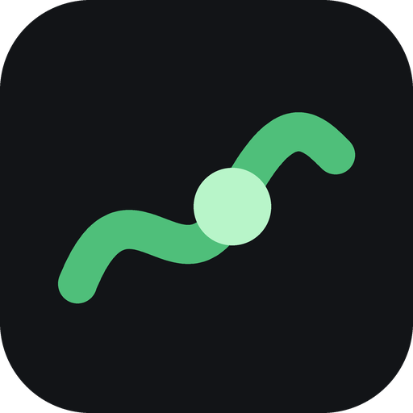

<p align="center">
  <picture>
    <source media="(prefers-color-scheme: dark)" srcset="https://raw.githubusercontent.com/arjunkai/wormscore/main/docs/img/logo-dark.png">
    
  </picture>
</p>

<h1 align="center">wormscore</h1>

<p align="center">
  <a href="https://github.com/arjunkai/wormscore/releases/latest/download/wormscore-windows.zip"></a>
  <a href="https://github.com/arjunkai/wormscore/releases/latest/download/wormscore-mac.zip"></a>
</p>

<p align="center">
  <a href="https://doi.org/10.5281/zenodo.23520610"></a>
  <a href="https://pypi.org/project/wormscore/"></a>
  <a href="https://github.com/arjunkai/wormscore/blob/main/LICENSE"></a>
  <a href="https://github.com/arjunkai/wormscore/actions/workflows/tests.yml"></a>
</p>

Blind scoring of fluorescent neurons in *C. elegans*, with measurement and genetics statistics.
Built for scoring reporter neurons (normal / dim / missing) in confocal z-stacks. Nothing is tied
to one neuron, marker or microscope: those are settings in each project's `config.json`, so other
organisms work the same way.

- **Blind:** every image gets a random code. Genotypes and file names stay in a sealed key
  until you finish scoring.
- **Fixed display:** every image from the same microscope is shown with the same brightness range.
  You can page through z-planes, turn the stack in 3D and overlay brightfield.
- **Measured, not decided:** suggested cell bodies and your drawn regions are measured (peak, mean,
  local background, sharpest plane, saturation). The numbers are written to files and never shown
  while you score. The software never labels a cell normal, dim or missing.
- **Traceable:** every number links to the exact file, path, series and SHA-256 checksum it came from.
- **Reproducible:** every parameter and software version is appended to `log.md` on each run.
- **Local:** runs on your computer only. Nothing is uploaded.

Supported raw formats: Leica `.lif`, Zeiss `.czi`, OME-TIFF (including Micro-Manager style files with
a `.companion.ome`), Nikon `.nd2`, Olympus FluoView `.oib` and `.oif`, and ImageJ hyperstack TIFF (only
where you turn it on, because ImageJ files do not record which channel is which). Channel identity
(marker vs brightfield) is read from metadata, never guessed.

**Not GFP?** Set `"marker": {"preset": "mCherry"}` (or mNeonGreen, YFP, TagRFP, mScarlet, mKate2,
BFP). **Have a second marker that labels the cell,** such as a pan-neuronal mCherry? Add
`"identity": {"preset": "mCherry"}`: the scoring page can then show the reporter, the identity
marker or both (keys 1, 2, 3), and suggested cells are found on the identity marker and the reporter is
measured there, so a dim or missing reporter cell is still found. See
[docs/METHODS.md](https://github.com/arjunkai/wormscore/blob/main/docs/METHODS.md) sections 2 and 6.

## Install

**Windows, no Python needed:** click **Download for Windows** above (or get `wormscore-windows.zip`
from the [Releases page](https://github.com/arjunkai/wormscore/releases)), unzip it, and double-click `wormscore.exe`. It opens in its own window (drawn by WebView2, the web engine built into Windows 10 and 11, so it behaves like any other app: one taskbar button, and it closes when you close its window). Your projects are on the left and the
five steps (Scan data, Score form, Build blind set, Score, Unblind) as a guided list with progress and time left.
The older launcher window is still there for one version: `wormscore.exe --classic`.

**Mac (Apple silicon, M1 and newer), no Python needed:** click **Download for macOS** above, unzip,
and drag `wormscore.app` into Applications. The app is not signed with a paid Apple developer
account, so the first time macOS blocks it: close the warning, then open **System Settings > Privacy &
Security** and click **Open Anyway**. It opens in your web browser. On an Intel Mac, use Python below.

**With Python 3.12 or newer:**

```
pip install wormscore
```

The newest code from GitHub: `pip install git+https://github.com/arjunkai/wormscore.git`

This installs a `wormscore` command and `wormscore-launcher`, which opens the same app window (in your
default browser on macOS and Linux).

### Updates

wormscore is young and new versions come out often. Each new feature is off until you turn it on,
so a project that does not use it scores, measures and reports exactly as before, and every version
stays downloadable from the [Releases page](https://github.com/arjunkai/wormscore/releases) so an
analysis can be rerun on the version it used. For a study, keep one version from building the blind
set to unblinding (the app reminds you), and cite that version.

From 0.8.0 the downloaded app (Windows and Mac) checks for a new version when it starts. If there is
one, a banner shows what is new with **Update and restart**, **Not now** and **Skip this version**.
Update downloads the zip for your computer, checks it against the SHA-256 checksum GitHub lists for
it, runs the new copy once to confirm its version, and swaps it in after the app closes. The previous
version is kept: **Settings > Go back to ...** swaps it back. Projects, codes and scores are never
touched. From the command line: `wormscore update`, `wormscore update --install`,
`wormscore update --rollback`.

If a project has a blind set built but is not unblinded yet, the banner warns that updating would
put two wormscore versions in that project's Methods, and **Not now** becomes the default. Update
before you build a blind set or after you unblind.

Copies installed with pip are told to run `pip install -U wormscore` instead. Turn the check off in
Settings (the gear at the top). Versions before 0.8.0 need one manual download.

## Try it in two minutes (simulated data)

```
wormscore demo my_demo
wormscore inventory my_demo
wormscore prepare my_demo
wormscore app my_demo
```

`demo` writes 20 simulated worm heads (controls with two normal cells; mutants with cells that are
normal, dim or missing at random) and a `demo_truth.csv` you can check your calls against later.
`wormscore demo my_demo --identity` adds an mCherry identity channel that marks every cell.
In the app window, use **Try a demo...**, then the steps in order: **Scan data > Build blind set > Score**.

**Real worms:** `wormscore demo my_demo --real` (or **Real worm images** in the app's demo dialog) downloads four
L1 heads with an endogenous GFP reporter, about 150 MB, from
[Sun and Hobert 2021](https://doi.org/10.1038/s41586-021-04071-4)
([Zenodo 5602160](https://doi.org/10.5281/zenodo.5602160), CC BY 4.0). Each file is checked against its
MD5 from the Zenodo record and cached in `%LOCALAPPDATA%\wormscore\demo_cache` (`~/.cache` elsewhere).
The two reporters stand in for two genotypes; both are normal animals, so this is for practice.
The images are not part of this repository.

## Using it on your own images

1. **Copy your data** to a local folder:
   `wormscore copy D:\from\drive C:\data\my_copy` copies every file, checks each one by SHA-256 and
   makes the copies read-only.
2. **Make a project:** in the app, **New project...** opens **Project settings**: choose each folder of
   images and write the genotype rules (a pattern such as `*ctrl*` and the genotype it means). The page
   counts how the rules sort the scanned images, so a typo shows before you build anything. Images can be
   left out by pattern there too. Images do not need converting: wormscore reads the microscope files
   as they are. The **Scoring form** section of the same page sets what the scorer answers for each
   image, with a live preview of the score panel:
   - start from **Fate reporter** (each neuron normal / dim / missing, the default), **Axon guidance**
     (yes/no questions about the axon), **Neurodegeneration** (each dendrite scored 0 to 6),
     **Dendrite length** (full / partial / short) or **Blank**;
   - name the neurons and the calls, and tick which calls count as a defect;
   - add questions, each asked **for each neuron** or **once per animal**, with an optional
     "can't tell" answer (never counted as an answer: that neuron or animal is left out), whether it is
     required, and calls for which it is skipped (for example "not seen"). Four answer types:
     - **Yes / No** and **Choice**: tick the answers that count as a defect. Questions with the same
       outcome name are combined (the animal has that defect if any answer is a defect), and each
       outcome gets Fisher's exact tests at unblinding;
     - **Scale**: levels in order, best first and worst last (for example 0 to 6, or full / partial /
       short);
     - **Count**: whole numbers from a lowest to a highest, the last optionally "that many or more"
       (for example 0 to 5+).

     A scale or count with an outcome name is tested on its own. Each animal gets one value: for a
     question asked for each neuron, the **worst neuron** (default) or the mean of the assessed neurons
     for a scale, and the total (default) or the mean per neuron for a count. Genotypes are compared
     with the **Mann-Whitney test** on those values, with an exact permutation p-value (correct with
     the many ties short scales have). An optional **cutoff** (for example "4 or worse") also gives
     the share of animals at or past it, tested with Fisher's exact test;
   - name one **primary outcome**; the results and Methods then call every other test secondary.

   On the home screen this is step 2, **Score form**: **Check score form...** opens this section, and
   pressing Save records the form in `log.md` even if you keep the default, so the step shows Done.
   Every save of the form is written to `log.md`, and the form **locks at the first score** (or once a
   second-scorer package exists), so the questions cannot change while you score. If `config.json` is
   edited by hand afterwards, unblinding runs no test and says why. The marker and statistics settings are still
   in `config.json`; see
   [`examples/config_example.json`](https://github.com/arjunkai/wormscore/blob/main/examples/config_example.json).
   From the command line: `wormscore init C:\projects\my_project`, then edit `config.json`. Once
   scoring has started, the folders and rules that built the blind set are locked; you can still add a
   folder for **Add new images**.
3. **Scan:** `wormscore inventory my_project` lists every file (`outputs/manifest.csv`: raw image,
   duplicate, derived projection, reference, hidden system file) and every image with its metadata
   and channel identity (`outputs/inventory.csv`). Check the flags column.
4. **Build the blind set:** `wormscore prepare my_project` applies the inclusion rules, assigns codes,
   finds and measures suggested cells, and writes the sealed key. Excluded images and the reasons are
   in `outputs/excluded.csv`. To leave out images by name (for example a plate with the wrong
   reporter), add `"exclude": [{"match": "*pattern*", "reason": "why"}]` to that source.
   Images taken after scoring started can be added with `wormscore prepare my_project --add-new-images`
   (scan first): existing codes stay the same and new images get codes after the last one.
5. **Score:** `wormscore app my_project`. For each image: answer any yellow questions, score each
   neuron, save, then outline each cell body (or accept a suggestion) and save regions.
   Answers you have not saved yet are kept as a draft (`scoring_drafts/`, never counted as scores),
   so a crash or restart loses nothing: open the image again and click Save. If the connection to
   wormscore is lost, the window shows "Reconnecting..." and reconnects by itself; if wormscore is not
   running it says so, with a Start wormscore button (Windows app).
6. **Unblind after scoring:** `wormscore unblind my_project --i-have-finished-scoring`. Writes
   `outputs/unblinded/merged.csv` (scores + numbers + key, one row per image), a summary, and results
   tables: `per_neuron.csv` (one row per animal and neuron, for plotting), `penetrance.csv` (animals with
   0, 1, 2 ... affected neurons) and `fisher_tests.csv` (Fisher's exact within each microscope,
   Bonferroni-corrected). Set `unblinding.reference_genotype` in `config.json` to test against a control.
   Optional, off unless set in `unblinding`: `question_outcomes` turns the per-neuron questions into
   the same penetrance and Fisher tables (for example "process defect" when a dendrite question is
   answered "no"), `rank_outcomes` (set by the builder for scale and count questions) writes
   `rank_outcomes.csv` (per genotype: animals, animals left out and why, median and quartiles, % at
   each level or the mean, the share at the cutoff) and `rank_outcome_tests.csv` (Mann-Whitney with
   the effect size: the chance a genotype_a animal scores worse than a genotype_b animal, and Cliff's
   delta), and `interaction` tests a double mutant against the value two single mutants predict
   (Product model by default) with a binomial test. Also optional: a secondary definition of "affected"
   (descriptive, within one microscope), planned comparisons, one-sided tests, labelled sources,
   comparisons across microscopes for chosen measures (with warnings), and a measured background cutoff
   (`dim_cutoff_sd`) for checking calls against numbers afterwards. Set `reliability.repeat_fraction`
   (for example 0.1) before building the blind set to hide repeat images; unblinding then reports how
   consistently you scored them (`reliability.csv`). All of these are recorded as an
   analysis plan before scoring and locked once scoring starts. See [docs/METHODS.md](https://github.com/arjunkai/wormscore/blob/main/docs/METHODS.md#8-unblinding).
   `methods_text.md` is a draft Methods paragraph on blinding, measurement and statistics; fill in the
   `blinding` section of `config.json` (who coded, who scored) or edit the [brackets] it leaves.
7. **Second scorer (optional):** after building the blind set, use **Make a package...** in the
   **Second scorer** card on the home page (or `wormscore export-scorer my_project D:\for_sam --scorer "Sam K" --percent 30`).
   Choose a name and a share of each genotype's images (1 to 100%, at least one image per genotype,
   picked at random). The package is a folder with those coded images in a new random order and the
   scoring form. It has no key, no file names, no analysis plan and no checksum list. Zip it and send
   it. The second scorer opens the folder in wormscore, which then shows only **Score**, and sends the
   folder back when finished. **Import scores...** (or `wormscore import-scorer my_project D:\from_sam`)
   checks that it is the package made from this project with the same images and scoring form, and
   stores the answers in `scorers/`. Your own scores are never changed. At unblinding,
   `between_scorers.csv` gives percent agreement and Cohen's kappa for each answer,
   `scorer_disagreements.csv` lists each image where the answers differ (codes only), and the Methods
   draft gets a sentence about it. All results tables still use only your answers.

## Project folder

| Path | Contents | Open while scoring? |
|---|---|---|
| `config.json` | every parameter | yes |
| `log.md` | every run: parameters, software versions, counts | yes |
| `outputs/manifest.csv`, `inventory.csv`, `excluded.csv` | what was found and what was left out | yes |
| `outputs/auto_measurements.csv` | numbers for suggested spots | avoid until done |
| `blind/` | images for scoring, named by code | used by the app |
| `scoring/` | your scores, regions and their measurements | scores yes; avoid `roi_measurements.csv` |
| `scorers/` | second scorers' packages (which images, checksums) and their returned scores | not needed |
| `key/` | code to file, genotype, settings | **no, not until scoring is finished** |

## How it works

See [docs/METHODS.md](https://github.com/arjunkai/wormscore/blob/main/docs/METHODS.md) for every step in plain language, suitable for adapting into
a Methods section, including the measurement definitions and their limits.

## Roadmap

Planned features are in [ROADMAP.md](https://github.com/arjunkai/wormscore/blob/main/ROADMAP.md).

## Development

```
pip install -e .[dev]
pytest
```

The tests build a simulated project and check the measurements, the blinding (no genotype or file
name reaches the scoring page), code stability, the unblinding locks and traceability. Leica and
Zeiss readers are checked against real files locally; real images are never committed.

Build the Windows app: `packaging\build_windows.bat`.

## Privacy

This repository contains code only. `.gitignore` excludes image formats, keys, scores and outputs.
Do not commit or upload data that belongs to someone else.

wormscore never sends your images, projects or scores anywhere. The only network requests are the
update check (one request to GitHub's latest-release page, sending nothing but the app's version in
the User-Agent; off switch in Settings), an update you choose to install, and the real-image demo
download.

## License and citation

MIT License (see [LICENSE](https://github.com/arjunkai/wormscore/blob/main/LICENSE)). If you use wormscore in research, please cite the version you used.
Each release has its own DOI on Zenodo; [doi:10.5281/zenodo.23520610](https://doi.org/10.5281/zenodo.23520610)
lists all versions and resolves to the latest. GitHub's "Cite this repository" button (from
[CITATION.cff](https://github.com/arjunkai/wormscore/blob/main/CITATION.cff)) gives the reference, as does
**Settings > Copy citation** in the app. `log.md` in your project records which version ran each step.

wormscore reads Leica files with [liffile](https://github.com/cgohlke/liffile), Zeiss files with
[czifile](https://github.com/cgohlke/czifile), Olympus FluoView files with
[oiffile](https://github.com/cgohlke/oiffile) and Nikon files with [nd2](https://github.com/tlambert03/nd2)
(all BSD-3). With pip, Nikon support is an extra: `pip install "wormscore[nd2]"`. The Windows and Mac
apps bundle these and other libraries; their licenses are in `THIRD_PARTY_LICENSES.txt` next to the app.
