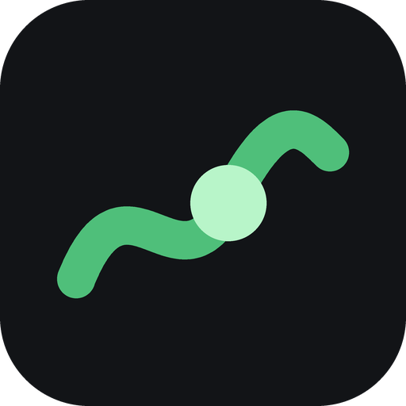
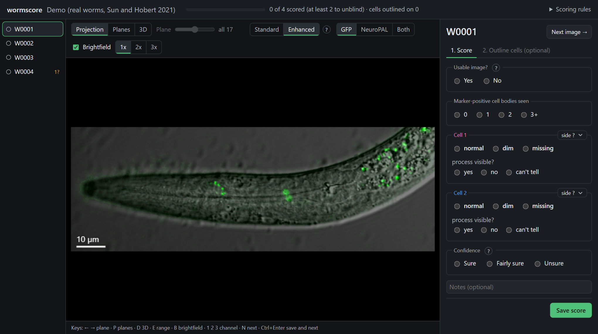
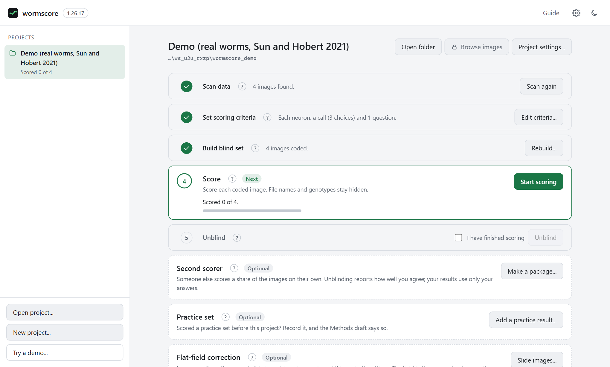

<p align="center">
  <picture>
    <source media="(prefers-color-scheme: dark)" srcset="https://raw.githubusercontent.com/arjunkai/wormscore/main/docs/img/logo-dark.png">
    
  </picture>
</p>

<h1 align="center">wormscore</h1>

<p align="center">
  <a href="https://github.com/arjunkai/wormscore/releases/latest/download/wormscore-windows.zip"></a>
  <a href="https://github.com/arjunkai/wormscore/releases/latest/download/wormscore-mac.zip"></a>
</p>

<p align="center">
  <a href="https://doi.org/10.5281/zenodo.23520610"></a>
  <a href="https://pypi.org/project/wormscore/"></a>
  <a href="https://github.com/arjunkai/wormscore/blob/main/LICENSE"></a>
  <a href="https://github.com/arjunkai/wormscore/actions/workflows/tests.yml"></a>
</p>

Blind scoring of fluorescent neurons in *C. elegans* confocal stacks, with measurement and genetics
statistics. You score coded images without knowing the genotype; wormscore keeps the key sealed, measures
the cells, and writes the tables, the tests and a draft Methods paragraph when you unblind.

<p align="center">
  
</p>
<p align="center"><sub>The scoring page. The image is from the real-worm demo: an L1 head with a GFP reporter, from Sun and Hobert 2021 (<a href="https://doi.org/10.5281/zenodo.5602160">Zenodo 5602160</a>, CC BY 4.0).</sub></p>

- **Blind:** every image gets a random code. Genotypes and file names stay in a sealed key until you
  finish scoring.
- **Fixed display:** every image from the same microscope is shown with the same brightness range, in
  planes, as a projection or in 3D.
- **Measured, not decided:** suggested cells and the regions you draw are measured (peak, mean, local
  background, sharpest plane, saturation). The numbers are never shown while you score, and the software
  never makes a call for you.
- **Traceable and reproducible:** every number links to its file, series and SHA-256 checksum, and every
  parameter and software version is written to the project's `log.md`.
- **Local:** it runs on your computer. Nothing is uploaded.

It reads microscope files as they are: Leica `.lif`, Zeiss `.czi`, Nikon `.nd2`, Olympus `.oib`, `.oif` and
`.oir`, OME-TIFF, and ImageJ hyperstack TIFF. Which channel is the reporter and which is brightfield is
read from the file's metadata, never guessed. GFP is the default reporter; mCherry, YFP, NeuroPAL and
others are settings. Nothing is tied to one neuron, marker or organism.

## Install

**Windows:** click **Download for Windows** above, unzip, and double-click `wormscore.exe`. The app is
not signed, so the first time Windows asks before it runs. If it shows "Windows protected your PC", click
**More info**, then **Run anyway**; if it shows "The publisher could not be verified", click **Run**.

**Mac (Apple silicon, M1 and newer):** click **Download for macOS** above, unzip, and drag `wormscore.app`
into Applications. The app is not signed, so the first time macOS blocks it. To open it once:

1. Double-click `wormscore.app`. In the warning, click **Done** (not Move to Trash).
2. Open **System Settings > Privacy & Security**, scroll down to Security, and click **Open Anyway**
   next to wormscore. The button is there for about an hour after step 1.
3. Click **Open Anyway** again and confirm with your password or Touch ID.

Or, instead of steps 1 to 3, run this once in Terminal. It removes the mark macOS puts on downloaded
files and changes nothing else:

```
xattr -dr com.apple.quarantine /Applications/wormscore.app
```

**With Python 3.12 or newer** (any system, including Intel Macs): `pip install wormscore`, then run
`wormscore-launcher`. For Nikon files add the extra: `pip install "wormscore[nd2]"`.

The Windows app has its own window. On a Mac and with pip it opens in your web browser: use a normal
window, since private windows and some privacy settings change the image data (the scoring page warns
if yours does).

## Try it in two minutes

In the app, click **Try a demo...** and follow the five steps. Or from the command line:

```
wormscore demo my_demo
wormscore inventory my_demo
wormscore prepare my_demo
wormscore app my_demo
```

The demo is 20 simulated worm heads in two genotypes, with a `demo_truth.csv` to check your calls
against. **Real worm images** in the demo dialog (`wormscore demo my_demo --real`) downloads four real
L1 heads from [Sun and Hobert 2021](https://doi.org/10.1038/s41586-021-04071-4)
([Zenodo 5602160](https://doi.org/10.5281/zenodo.5602160), CC BY 4.0).

## How a project goes

<p align="center">
  <picture>
    <source media="(prefers-color-scheme: dark)" srcset="https://raw.githubusercontent.com/arjunkai/wormscore/main/docs/img/home-dark.png">
    
  </picture>
</p>

1. **Scan data:** lists every image with its metadata and which channel is which.
2. **Set scoring criteria:** what the scorer answers for each image. Start from a template (fate
   reporter, axon guidance, neurodegeneration, dendrite length, counts) or build your own.
3. **Build blind set:** gives every image a random code and writes the sealed key.
4. **Score:** answer the questions for each coded image, from the keyboard if you like, and optionally
   outline cells to measure them.
5. **Unblind:** when scoring is finished, reveals the genotypes and writes the results.

Unblinding writes one row per image with scores, measurements and genotype, penetrance per genotype,
Fisher's exact tests (and Mann-Whitney tests for scales and counts), and a draft Methods paragraph.
The analysis settings are recorded before scoring and locked while you score.

Optional: a second scorer for agreement between scorers, hidden repeat images, practice sets for new
scorers, flat-field correction, and checks for bleed-through and gut autofluorescence.

**On a new microscope, check the reading first.** After Scan data, open `outputs/inventory.csv` and compare
one image's objective, pixel size, bit depth, channels and settings with what your microscope software
shows. If anything differs, [open an issue](https://github.com/arjunkai/wormscore/issues/new).

## Documentation

- [User guide](https://github.com/arjunkai/wormscore/blob/main/docs/GUIDE.md): every step and option, the scoring criteria, the results files.
- [Methods](https://github.com/arjunkai/wormscore/blob/main/docs/METHODS.md): how everything is read, measured and tested, in plain language,
  for adapting into a Methods section.
- [Comparison with other tools](https://github.com/arjunkai/wormscore/blob/main/docs/COMPARISON.md).
- [Roadmap and what changed in each version](https://github.com/arjunkai/wormscore/blob/main/ROADMAP.md).

Something wrong, unclear or missing? [Open an issue](https://github.com/arjunkai/wormscore/issues/new)
with what you did and what you saw. The project's `log.md` helps; it never names a code's genotype.

## Updates

The downloaded app checks for a new version when it starts and offers **Update and restart**. The
previous version is kept: **Settings > Go back** restores it. Updating does not change your results: new
options only run if you set them, and projects, codes and scores are never touched. For a study, keep
one version from building the blind set to unblinding (the app reminds you) and cite that version.
Every version stays on the [Releases page](https://github.com/arjunkai/wormscore/releases). With pip:
`pip install -U wormscore`. Details are in the [user guide](https://github.com/arjunkai/wormscore/blob/main/docs/GUIDE.md#updates).

## Privacy

This repository contains code only. `.gitignore` excludes image formats, keys, scores and outputs.
Do not commit or upload data that belongs to someone else.

wormscore never sends your images, projects or scores anywhere. The only network requests are the
update check (one request to GitHub's releases API for the latest version, sending nothing but the
app's version in the User-Agent; off switch in Settings), an update you choose to install, and the real-image demo
download.

## License and citation

MIT License (see [LICENSE](https://github.com/arjunkai/wormscore/blob/main/LICENSE)). If you use wormscore in research, please cite the version you used.
Each release has its own DOI on Zenodo; [doi:10.5281/zenodo.23520610](https://doi.org/10.5281/zenodo.23520610)
lists all versions and resolves to the latest. GitHub's "Cite this repository" button (from
[CITATION.cff](https://github.com/arjunkai/wormscore/blob/main/CITATION.cff)) gives the reference, as does
**Settings > Copy citation** in the app. `log.md` in your project records which version ran each step.

wormscore reads Leica files with [liffile](https://github.com/cgohlke/liffile), Zeiss files with
[czifile](https://github.com/cgohlke/czifile), Olympus FluoView files with
[oiffile](https://github.com/cgohlke/oiffile), Olympus `.oir` files with
[oirfile](https://github.com/cgohlke/oirfile) and Nikon files with [nd2](https://github.com/tlambert03/nd2)
(all BSD-3). The Windows and Mac
apps bundle these and other libraries; their licenses are in `THIRD_PARTY_LICENSES.txt` next to the app.

## Development

```
pip install -e .[dev]
pytest
```

The tests build simulated projects and check the measurements, the statistics, the blinding (no genotype
or file name reaches the scoring page) and the file readers. Real images are never committed. GitHub
builds the Windows and Mac apps on every change and installs an update over them.
