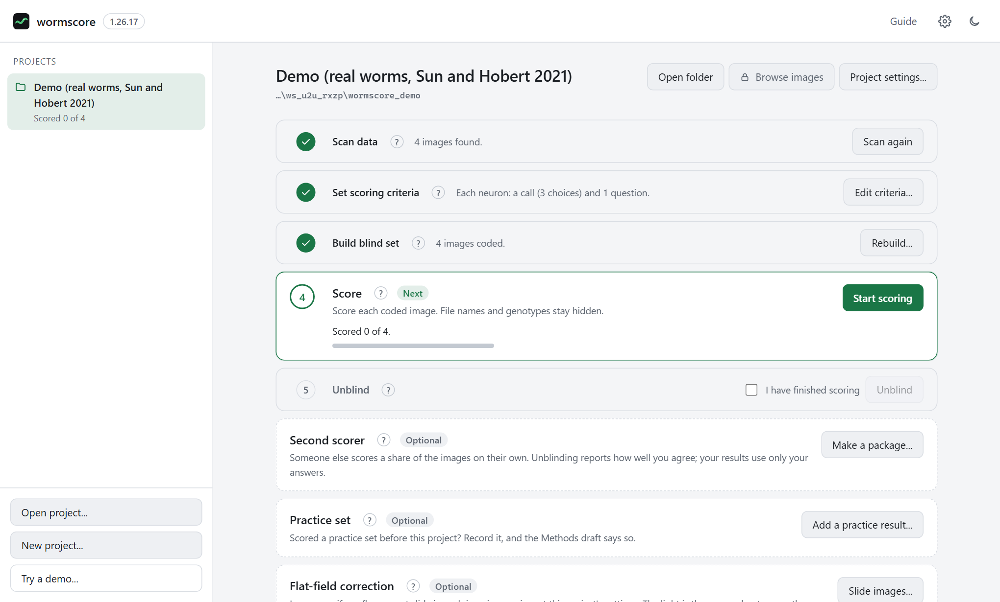
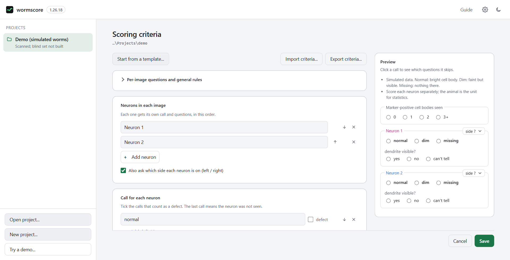
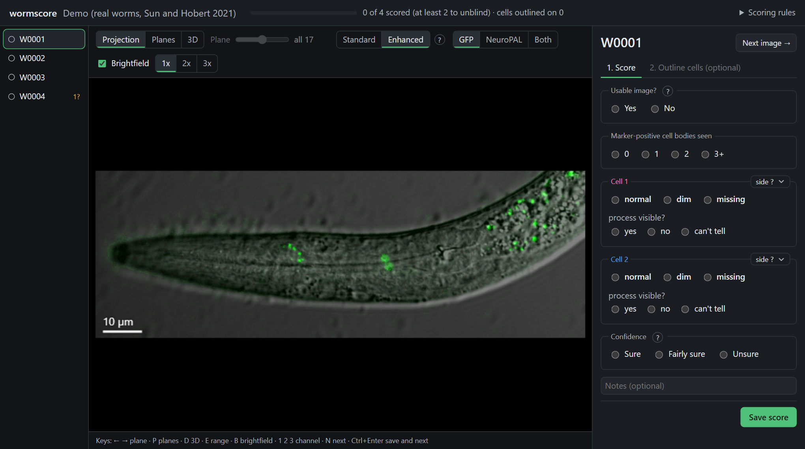
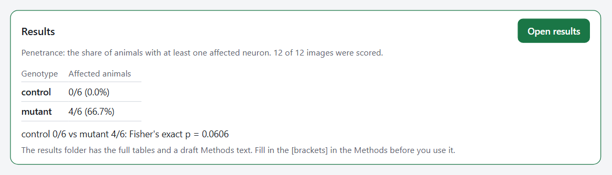
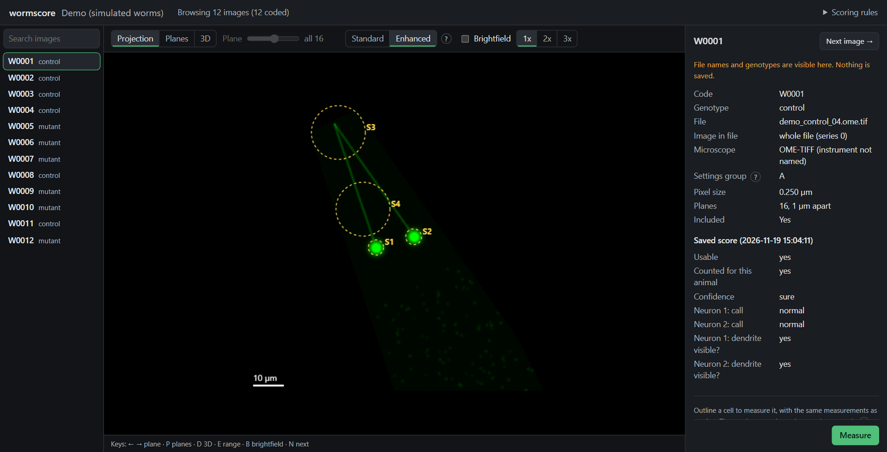

# wormscore user guide

Everything the app does, step by step. The [README](../README.md) is the short version.
[METHODS.md](METHODS.md) says how each number is computed and what to write in a paper.

**Contents**

- [Before you start](#before-you-start): check the reading of one file, copy your data, make a project
- [The five steps](#the-five-steps): Scan data, Set scoring criteria, Build blind set, Score, Unblind
- [Browse images](#browse-images)
- [Scoring criteria](#scoring-criteria)
- [Markers and identity channels](#markers-and-identity-channels)
- [Results](#results)
- [Analysis settings](#analysis-settings)
- Optional features: [hidden repeats](#hidden-repeats), [a second scorer](#a-second-scorer),
  [a practice set](#a-practice-set), [flat-field correction](#flat-field-correction),
  [bleed-through check](#bleed-through-check), [gut autofluorescence check](#gut-autofluorescence-check)
- [Project folder](#project-folder)
- [Updates](#updates)
- [The demo](#the-demo)
- [File formats](#file-formats)
- [Other ways to run wormscore](#other-ways-to-run-wormscore)
- [If something goes wrong](#if-something-goes-wrong)

The home screen shows the five steps in order, with progress and time left. Each step also has a
command, given here in `code`, for the command line or a script. A small **?** next to a term (blind
set, ROI, settings group, primary outcome and others) gives a one-sentence definition: click it or
press Enter; Escape closes it.

## Before you start

**Check the reading of one file first** (two minutes, once per microscope). Click **Check the
reading...** under Scan data (shown until the blind set is built) and choose one microscope file
(`wormscore check-reading <file>`; `--series N` for another image of the file, `--project <folder>` to
use a project's markers instead of a GFP reporter; in the app the open project's markers are used).
It lists, for one image, what Scan data would record: objective, pixel size, z-step, planes, bit depth,
each channel with its role, and the reporter's detector, laser and averaging settings. Each value comes
with where Leica LAS X, Zeiss ZEN, Nikon NIS-Elements or the Olympus FluoView software shows it. Open
the same image there and compare. It reads only the file's metadata and changes nothing. If a value
differs, [open an issue](https://github.com/arjunkai/wormscore/issues/new) with the text (the Copy
button copies it).

**Copy your data to a local folder** (recommended).
`wormscore copy D:\from\drive C:\data\my_copy` copies every file, checks each one by SHA-256 and makes
the copies read-only.

**Make a project.** **New project...** opens **Project settings**
(`wormscore init C:\projects\my_project`, then edit `config.json`).

- Choose each folder of images. Images do not need converting: wormscore reads the microscope files
  as they are.
- Write the genotype rules: a pattern such as `*ctrl*` and the genotype it means. The page counts how
  the rules sort the scanned images, so a typo shows before you build anything.
- Leave images out by pattern if you need to.
- Choose the markers and the main analysis settings. The remaining settings are in `config.json`; see
  [`examples/config_example.json`](https://github.com/arjunkai/wormscore/blob/main/examples/config_example.json).

## The five steps



### 1. Scan data

`wormscore inventory my_project`

Lists every file in `outputs/manifest.csv` (raw image, duplicate, derived projection, reference,
hidden system file) and every image in `outputs/inventory.csv`, with its metadata and which channel is
which. Check the flags column.

A file that cannot be read (damaged, cut short, or open in the microscope software) is listed with
the reason and left out. It never stops the scan or the build.

### 2. Set scoring criteria

**Set criteria...** opens the criteria: what the scorer answers for each image (see
[Scoring criteria](#scoring-criteria)). Pressing Save records them in `log.md`, even if you keep the
defaults. They lock at the first score.



On the command line this step is optional: the criteria in `config.json` (the defaults unless you
changed them) are recorded when you build the blind set.

### 3. Build blind set

`wormscore prepare my_project`

Applies the inclusion rules, gives every image a random code, finds and measures suggested cells, and
writes the sealed key. The first build asks before it starts, and offers to set the criteria first if
you have not saved them. Excluded images and the reasons are in `outputs/excluded.csv`.

**Leaving images out by name.** For example a plate with the wrong reporter: add
`"exclude": [{"match": "*pattern*", "reason": "why"}]` to that source.

**Images taken after scoring started.** Scan data again, then click **Add or rebuild...** on the
Build step and choose **Add new images** (`wormscore prepare my_project --add-new-images`). Existing codes stay the same and new images get
codes after the last one.

**After scoring has started,** the folders and rules that built the blind set are locked. You can
still add a folder for new images. **Change anyway...** unlocks them with a reason, which is written
to `log.md`:

- A moved or renamed folder is followed by the coded images.
- A corrected genotype rule is applied to the coded images. Each change is listed in
  `key/changes_after_scoring.csv`.
- A new exclusion rule leaves matching images out at unblinding. The summary and the Methods draft
  say so.

### 4. Score

`wormscore app my_project`

For each coded image:

1. Answer any yellow questions. They ask you to confirm something about the image.
2. Give each neuron its call and answer the other questions.
3. Click **Save score**.
4. Optional: outline each cell body, or accept a suggestion, and click **Save outlines**.



**Keyboard.** Every question is a row of buttons. Tab to a question and press the number of the answer
(1 for the first); the focus moves to the next question. The numbers show on the question that has the
focus. **Ctrl+Enter** saves and opens the next unscored image. **N** (or **Next image**) moves on
without saving. In a project with an identity channel, 1, 2 and 3 switch the channel, so answer with
the mouse or the arrow keys.

**Unsaved answers are kept.** They are stored as a draft (`scoring_drafts/`, never counted as scores).
After a crash or a restart, open the image again and click Save.

**Interim totals...** on the Score step shows your answers so far, pooled over all images: images
scored and not usable (and why), the calls, the share of animals with a defect call, confidence, time
per image and time left. It also compares the first and second half of the images you scored. Codes
are in random order, so a large difference suggests the criteria are being applied differently over
time. Nothing is shown by genotype or about hidden repeats, not even counts, since a count that
changes after a save would reveal that image's genotype. Each look is recorded in `log.md`, and the
Methods draft says how many were taken.

### 5. Unblind

`wormscore unblind my_project --i-have-finished-scoring`

Only when scoring is finished. Reveals the genotypes and writes the results tables and a draft Methods
paragraph (see [Results](#results)). The confirmation says how many images are scored and that
unscored ones are left out. Afterwards a **Results** card at the top of the project shows the
penetrance per genotype and the planned Fisher tests, with **Open results**.



A score saved or changed after the first unblinding is no longer blind. The summary, `merged.csv` and
the Methods draft mark it.

## Browse images

`wormscore browse my_project`

**Browse images**, at the top of the project next to Open folder and Project settings, opens the
scoring viewer with each image's file name and genotype. Use it after Scan data to check images and to
decide the scoring criteria. It has the same views as scoring (planes, 3D, channels, both display
ranges, suggested cells), and you can outline a cell to see its measurements on screen. Nothing is
scored or saved.



- **It is recorded.** Each image you open before the build is written to `log.md` and
  `outputs/browsed_images.csv`, and the Build log and the Methods draft say how many images were seen.
  ARRIVE 2.0 item 5 asks who knew the groups at each stage.
- **It is off while you score,** from Build blind set until Unblind, and in a second scorer's package.
  The button shows a lock and says why.
- **After unblinding** it opens again, to look up a code (for example W0010) with its genotype, file
  and saved score.
- **Brightness before the build.** Enhanced is set from each image alone until the blind set exists,
  so compare brightness between images with Standard.
- **If the key folder is moved away during scoring** (some labs keep it elsewhere to keep it sealed),
  Browse stays off. Put the key back before you build again or unblind: once scores are saved, a build
  without the key is refused.

## Scoring criteria

**Set criteria...** on step 2 (later **Edit criteria...**, and **View criteria** once they are
locked) opens the criteria on their own page, with a live preview of the score panel. Project settings
has the project name and image folders. Older versions and `log.md` call the criteria the score form.

### Templates

**Start from a template...** offers:

| Template | What the scorer answers |
|---|---|
| **Fate reporter** (what a new project starts with) | each neuron on / dim / off, with dim judged against wild type at the same settings |
| **Axon guidance** | yes/no questions about the axon, phrased around its target, and whether it crosses the ventral midline |
| **Neurodegeneration** | each dendrite scored 0 to 6 |
| **Dendrite length** | full length / short; add a partial level if you need one |
| **Counts and position** | marker-positive cells counted on the left and on the right side, and each neuron's cell body in place, anterior or posterior |
| **Blank** | nothing yet |

Each template follows published scoring and names its source in the list and in its rules. Projects
made before 1.10.0 keep normal / dim / missing.

### Neurons, calls and definitions

- **Neurons and calls:** name the neurons and the calls, and tick which calls count as a defect.
- **What each answer means:** each call, and each answer of a Choice or Scale question, can have a
  short definition and a **reference image** (PNG or JPEG), for example what "dim" looks like. The
  scoring page shows them in a **What each answer means** box above the neurons. Click a thumbnail to
  see it larger, beside the image being scored. A definition is also the answer's tooltip.
- **Reference images** should come from outside the blind set, such as a pilot or a published figure.
  They are copied into the project's `criteria/` folder and go into second-scorer packages. The
  definitions and each image's SHA-256 are written to `log.md` with the criteria, and the Methods
  draft says they were shown.
- **Rules:** the general rules list is for instructions that are not about one answer.

### Extra questions

Each extra question is asked **for each neuron**, **for each side** (left and right, for example the
cells counted on each side) or **once per animal**. For each you set:

- an **Outcome** name, which says what the question measures (for example "process defect");
  questions with the same outcome name are combined, and only questions with one are tested;

- whether it is required;
- an optional "can't tell" answer, which is never counted as an answer: that neuron, side or animal is
  left out;
- the calls for which it is skipped, for example "not seen" (only neurons have a call).

A question for each side is shown once, with a Left and a Right row of answers, and saved as
`left_<id>` and `right_<id>`. For a Yes / No or Choice outcome each side is assessed like a neuron.

There are four answer types:

| Type | Answers | How it is tested |
|---|---|---|
| **Yes / No**, **Choice** | tick the answers that count as a defect | Questions with the same outcome name are combined (the animal has that defect if any answer is a defect). Each outcome gets Fisher's exact tests at unblinding. |
| **Scale** | levels in order, best first and worst last (0 to 6, or full length / partial / short) | Mann-Whitney test, see below |
| **Count** | whole numbers from a lowest to a highest, the last optionally "that many or more" (0 to 5+) | Mann-Whitney test, see below |

Above 5 levels the builder warns that scorers usually agree less on long scales. It points to the
weighted kappa that unblinding reports when there are hidden repeats or a second scorer.

### How scales and counts are tested

A scale or count with an outcome name is tested on its own; without one it is only recorded. Each animal gets one value:

- **Scale, asked for each neuron:** the worst neuron (default) or the mean of the assessed neurons.
- **Count, asked for each neuron:** the total (default) or the mean per neuron.
- **Asked for each side:** the same over the two sides (the worse side, or the total over both).

Genotypes are compared with the **Mann-Whitney test** on those values, with a permutation p-value,
which is correct with the many ties short scales have. It is exact when there are up to 100,000
rearrangements, otherwise from 100,000 random ones with a fixed seed.

An optional **cutoff** (for example "4 or worse") also gives the share of animals at or past it, tested
with Fisher's exact test.

### Other settings

- **Primary outcome:** name one. The results and the Methods draft then call every other test
  secondary.
- **Count for each image:** under **Per-image questions and general rules**, untick **Ask a count for
  each image** when cells are counted another way (the Counts and position template counts each side
  instead). The `cells_seen` column then stays empty.

### Sharing criteria between projects and labs

**Export criteria...** saves the criteria, with their definitions and reference images, as one
`.wormscore-criteria.json` file with a name, an optional version and an optional citation.

**Import criteria...** in another project reads the file. Nothing is saved until you press Save. It
says so if the file was changed after it was exported or has no checksum.

`log.md` records a SHA-256 checksum of the criteria in use, the same in every project for the same
criteria. For imported criteria the Methods draft names the source and says whether they were used as
published or adapted; for criteria made in the project it reads as it always did.

### The criteria lock at the first score

They also lock once a second-scorer package exists, so the questions cannot change while you score.
Every save is written to `log.md`.

If you must change them afterwards, **change them anyway...** on the locked criteria asks for a
reason and writes the change and the reason to `log.md`. Unblinding lists each change with its reason
in the summary and the Methods draft. **change them anyway...** is not offered once a second-scorer
package exists.

- **Fixing wording** (question text, rules, an answer's definition or reference image) keeps the
  planned tests.
- **Any other change,** in the app or by editing `config.json` by hand, means unblinding runs no
  planned test and says why. Descriptive tables are still written, and changing the criteria back
  runs the tests again.

Leaving the criteria or Project settings with unsaved changes asks whether to save them.

## Markers and identity channels

Set under **Markers** in **Project settings**, or in `config.json`.

- **Not GFP?** Choose the reporter: mCherry, mNeonGreen, YFP, TagRFP, mScarlet, mKate2 or BFP
  (`"marker": {"preset": "mCherry"}`).
- **A second marker that labels the cell,** such as a pan-neuronal mCherry? Choose it as the identity
  channel (`"identity": {"preset": "mCherry"}`). The scoring page can then show the reporter, the
  identity marker or both (keys 1, 2, 3). Suggested cells are found on the identity marker and the
  reporter is measured there, so a dim or missing reporter cell is still found.
- **NeuroPAL?** Choose NeuroPAL as the identity channel (`"identity": {"preset": "NeuroPAL"}`). Its
  four colours (TagRFP-T white, mNeptune2.5 red, CyOFP1 green, mTagBFP2 blue) are shown together in 2D
  and 3D, each scaled per image and never measured. GFP and CyOFP1 are both green, so use keys 1 and 2
  to see each on its own.
- **Your own set:** list up to four identity channels,
  `"identity": [{"preset": "mCherry"}, {"preset": "BFP"}]`. The first one finds the cells.

Markers are found at Scan data, so after a change run Scan data again and rebuild. Once scoring has
started they are locked. **Change anyway...** records the change and your reason in `log.md`; it is
not offered while a second-scorer package exists. See [METHODS.md](METHODS.md), sections 2 and 6.

## Results

Unblinding writes to `outputs/unblinded/`:

| File | Contents |
|---|---|
| `merged.csv` | scores, measurements and key, one row per image |
| `summary.txt` | the results in plain text: counts of calls, penetrance and the tests, brightness by call within each settings group, and any warnings |
| `per_neuron.csv` | one row per animal and neuron, for plotting |
| `penetrance.csv` | animals with 0, 1, 2 ... affected neurons |
| `fisher_tests.csv` | Fisher's exact tests within each microscope, Bonferroni-corrected |
| `methods_text.md` | a draft Methods paragraph on blinding, measurement and statistics |

To test against a control, choose it under **Analysis** in Project settings (**Compare each genotype
with**; `unblinding.reference_genotype` in `config.json`).

For the Methods draft, fill in the `blinding` section of `config.json` (who coded, who scored) or edit
the [brackets] it leaves.

## Analysis settings

All optional and off unless set. The outcomes come from the scoring criteria; the rest is under
**Analysis** in Project settings, or the `unblinding` section of `config.json`.

- Question outcomes (`question_outcomes`, set by the builder from each question's outcome name): turns the per-neuron questions into the same
  penetrance and Fisher tables, for example "process defect" when a dendrite question is answered
  "no".
- Scale and count outcomes (`rank_outcomes`, set by the builder): writes `rank_outcomes.csv` (per
  genotype: animals, animals left out and why, median and quartiles, % at each level or the mean, the
  share at the cutoff) and `rank_outcome_tests.csv` (Mann-Whitney with the effect size: the chance a
  genotype_a animal scores worse than a genotype_b animal, and Cliff's delta).
- **Genetic interaction** (`interaction`): tests a double mutant against the value two single mutants
  predict. The default model is independent effects (the product model); additive and same pathway
  are the others. A test set up in the app starts with the likelihood-ratio test, which allows for the
  single mutants' own sampling error. The binomial test (the default in `config.json`, kept for older
  projects) treats their rates as exact and so finds an interaction too often with small groups.
- **Only the pairs I list** (`comparisons`): tests only those pairs, with an optional **direction**
  (`alternative`; one-sided tests need listed pairs). Bonferroni counts only them.
- **Second definition of affected** (`secondary_defect_calls`): descriptive within one microscope
  unless **Test it too** is ticked.
- **Check of dim calls** (`dim_cutoff_sd`): a measured background cutoff for checking calls against
  numbers afterwards.
- **Compare across microscopes** (`allow_cross_microscope`): for chosen results, with warnings and the
  reason in the Methods draft.
- **Labelled sources** stay in `config.json`.

**These settings are the analysis plan.** They are recorded before scoring and locked once scoring
starts. **Change anyway...** on the locked card asks for a reason. The tests then run on the new
settings and are marked as not set before scoring, and the summary and the Methods draft call them
exploratory and give the reason. See [METHODS.md](METHODS.md#8-unblinding).

**Hidden repeats**, also under Analysis, are not part of the plan: they decide the codes, so they can
change only before scoring (see [Hidden repeats](#hidden-repeats)).

## Optional features

Each has its own card on the project's home page.

### Hidden repeats

Intra-rater reliability: how consistently one scorer scores the same image.

**Hidden repeats** under **Analysis** in Project settings (`"reliability": {"repeat_fraction": 0.1}`
in `config.json`)
shows that share of images a second time under new codes. Unblinding then reports how consistently you
scored them (`reliability.csv`).

The share decides the codes. Changing it once the blind set is built rebuilds the blind set with new
codes, which is possible only before scoring; after that it stays as it is.

### A second scorer

Inter-rater reliability: agreement between two people.

1. After building the blind set, click **Make a package...** in the **Second scorer** card on the
   home page (`wormscore export-scorer my_project D:\for_sam --scorer "Sam K" --percent 30`). Choose a name and
   a share of each genotype's images: 1 to 100%, at least one image per genotype, picked at random.
2. Zip the package folder and send it. It holds those coded images in a new random order (plus their
   hidden repeats, if you turned repeats on), the scoring criteria and the display settings. It has no
   key, no file names, no analysis plan and no checksum list.
3. The second scorer opens the folder in wormscore, which then shows only **Score**, and sends the
   folder back when finished.
4. **Import scores...** (`wormscore import-scorer my_project D:\from_sam`) checks that it is the
   package made from this project, with the same images and scoring criteria, and stores the answers
   in `scorers/`.

At unblinding, `between_scorers.csv` gives percent agreement and Cohen's kappa for each answer,
`scorer_disagreements.csv` lists each image where the answers differ (codes only), and the Methods
draft gets a sentence about it. Your own scores are never changed, and all results tables use only
your answers.

### A practice set

Training against an answer key. Before scoring for real, a new scorer can practise on images someone
has already scored.

1. In a finished (unblinded) project, click **Make a practice set...** in the **Practice set** card
   (`wormscore make-practice my_project D:\practice --n 20`). It copies that many coded images, taken
   in turn from each genotype, with your saved answers as the answer key. Only images you marked sure
   are used, unless you untick that or add `--any-confidence`. The set has no genotypes, file names
   or analysis plan; the key is in `practice_key.json`.
2. The new scorer opens the folder in wormscore and scores every image. The set then shows the
   agreement with the key for each answer (percent agreement and Cohen's kappa) and lists each image
   where the answers differ, with both answers.
3. In their own project, before scoring, they click **Add a practice result...**
   (`wormscore add-practice my_project D:\practice`). It checks the set, computes the agreement again
   from its files and writes it to `log.md` with the key's SHA-256 (the same value is in the log of
   the project the set was made from). The Methods draft says the scorer practised.

### Flat-field correction

Before scoring. Evens out the reporter's light across the field and between imaging sessions, so a
cell at the edge of the field is not judged dimmer than one in the middle.

1. In each imaging session, image a uniform fluorescent slide at the project's settings and, if you
   can, a few dark images with the light off.
2. Choose the folder on the **Flat-field correction** card.
3. Build. The correction is applied before anything is shown or measured. A blind set already built
   is rebuilt with the same codes.

It is recorded in `log.md` and the Methods draft.

- **A day without slide images** uses the nearest day's, with a warning. The build never stops for it.
- **Slide images for later days** can be added at any time with **Sessions... > Add slide images...**,
  also after scoring began. Images already coded do not change: once scoring has begun, added slide
  images are used only for images you add later, and a rebuild keeps every coded image as it was
  scored.

### Bleed-through check

For projects with an identity channel. Measures how much of one marker's light lands in the other
channel.

1. Image a few animals that carry one marker only, at the project's settings.
2. Choose their folder on the **Bleed-through check** card.

wormscore reports the bleed-through as a percentage and records it in `log.md` and the Methods draft.

- **Identity-only controls** matter most: that light would add to the measured reporter.
- **Reporter-only controls** show whether bright cells look brighter in the identity channel, which
  would make them easier to find.
- **With several identity channels (NeuroPAL),** the identity-only controls also fit the reporter
  channel to all of them together, so each one's share is separate from the others' (for example
  CyOFP1, excited at 488 nm like GFP).

### Gut autofluorescence check

After unblinding, for images that also recorded a channel with no label, such as blue. Gut granules
glow in every channel; the reporter does not.

**Check outlines** on the card measures each outline in the unlabelled channel and flags those that
are bright there too. The flags are listed by genotype in `outputs/unblinded/autofluorescence.csv`,
`log.md` and the Methods draft. **Browse images** then marks flagged codes and names their outlines.
Flags never change a call.

## Project folder

| Path | Contents | Open while scoring? |
|---|---|---|
| `config.json` | every parameter | yes |
| `log.md` | every run: parameters, software versions, counts | yes |
| `outputs/manifest.csv`, `inventory.csv`, `excluded.csv` | what was found and what was left out | yes |
| `outputs/browsed_images.csv` | images viewed with Browse images before the build (only if you browsed) | yes |
| `outputs/auto_measurements.csv` | numbers for suggested spots | avoid until done |
| `blind/` | images for scoring, named by code | used by the app |
| `scoring/` | your scores, regions and their measurements | scores yes; avoid `roi_measurements.csv` |
| `scorers/` | second scorers' packages (which images, checksums) and their returned scores | not needed |
| `key/` | code to file, genotype, settings | **no, not until scoring is finished** |

## Updates

**Updating does not change your results.** New analysis options (such as a new test or hidden repeat
images) only run if you set them, so an existing project scores, measures and reports exactly as
before. Screens and buttons may change. Projects, codes and scores are never touched.

**For a study, keep one version** from building the blind set to unblinding (the app reminds you), and
cite that version: update before you build a blind set or after you unblind.
Every version stays downloadable from the
[Releases page](https://github.com/arjunkai/wormscore/releases), so an analysis can be rerun on the
version it used. What changed in each version is in the [changelog](../CHANGELOG.md).

### The downloaded app (Windows and Mac)

The app checks for a new version when it starts. If there is one, a window shows what is new, with
**Update and restart**, **Not now** and **Skip this version**. Turn the check off in Settings (the
gear at the top).

Update does four things:

1. downloads the zip for your computer;
2. checks it against the SHA-256 checksum GitHub lists for it;
3. runs the new copy once to confirm its version;
4. swaps it in after the app closes.

**Going back.** The previous version is kept: **Settings > Go back to ...** swaps it back.

**If the swap cannot be done** (for example a file in the app folder is open in another program),
nothing is changed. The app and the kept copy stay as they were, and you can try again.

**If a project is between Build blind set and Unblind,** the update window warns that updating would
put two wormscore versions in that project's Methods. **Not now** becomes the default, and **Update
anyway** works only after you tick "I understand the Methods would cite two versions". Update before
you build a blind set or after you unblind.

**On a Mac whose app is on another disk than your home folder** (an external disk, for example), the
kept copy is in a hidden folder next to the app (`.wormscore-previous`), so the swap never copies an
app between disks.

**Old versions.** Versions before 0.8.0 cannot update themselves, and on a Mac neither can versions
before 1.26.5: download the new app once.

### From the command line

`wormscore update` checks, `wormscore update --install` installs, `wormscore update --rollback` goes
back. A copy installed with pip is told to run `pip install -U wormscore` instead.

## The demo

In the app: **Try a demo...**, then the steps in order (Scan data, Set scoring criteria, Build blind
set, Score, Unblind). From the command line:

```
wormscore demo my_demo
wormscore inventory my_demo
wormscore prepare my_demo
wormscore app my_demo
```

**Simulated worms.** `demo` writes 20 simulated worm heads, 10 per genotype (`--n` changes that):
controls with two normal cells, and mutants with cells that are normal, dim or missing at random.
`demo_truth.csv` holds the truth, to check your calls against later. `--identity` adds an mCherry
identity channel that marks every cell.

**Real worms.** `wormscore demo my_demo --real`, or **Real worm images** in the demo dialog,
downloads four larval heads with the flp-17::GFP reporter, about 230 MB, from
[Sun and Hobert 2021](https://doi.org/10.1038/s41586-021-04071-4)
([Zenodo 5602160](https://doi.org/10.5281/zenodo.5602160), CC BY 4.0).

- Each file is checked against its MD5 from the Zenodo record and cached in
  `%LOCALAPPDATA%\wormscore\demo_cache` (`~/.cache` elsewhere). The images are not part of this
  repository.
- flp-17 marks the BAG pair of sensory neurons, so every image shows the two cells the form asks
  about. Two L1 and two L2 larvae stand in for two genotypes. All are normal animals, and L2 heads are
  larger, so the group can be guessed from the size: this is for practice.
- The animals carry NeuroPAL, so the demo also shows its four colours (keys 1, 2, 3 switch between
  GFP, NeuroPAL and both).

## File formats

| Format | Notes |
|---|---|
| Leica `.lif` | |
| Zeiss `.czi` | |
| Nikon `.nd2` | with pip, needs the extra: `pip install "wormscore[nd2]"` |
| Olympus FluoView `.oib`, `.oif` | |
| Olympus `.oir` | FV3000, FV4000, FVMPE-RS |
| OME-TIFF | including Micro-Manager style files with a `.companion.ome` |
| ImageJ hyperstack TIFF | only where you turn it on, because ImageJ files do not record which channel is which |

Which channel is the marker and which is brightfield is read from metadata, never guessed.

## Other ways to run wormscore

- **The Windows app** draws its own window with WebView2, the web engine built into Windows 10 and
  11. The older launcher window is still available: `wormscore.exe --classic`.
- **With pip:** `pip install wormscore` installs a `wormscore` command and `wormscore-launcher`, which
  opens the same app window (in your default browser on macOS and Linux). The newest code from
  GitHub: `pip install git+https://github.com/arjunkai/wormscore.git`.
- **In a browser, score in a normal window.** Safari Private windows, Brave, and Firefox with
  fingerprinting protection change the image data a page reads back, which would show as speckle in
  the images. The scoring page checks for this when it opens and shows a warning above the image if
  the window does it.

**In the viewer** you can page through z-planes, turn and tilt the stack in 3D, see which plane the
brightest point under the cursor is in (a double-click opens it), and overlay brightfield.

## If something goes wrong

- **"Reconnecting to wormscore..."** The connection to wormscore was lost. The window reconnects by itself. If
  wormscore is not running, the window says so; in the Windows app it has a **Start wormscore**
  button.
- **The app closed while you were scoring.** Unsaved answers are kept as a draft. Open the image
  again and click Save.
- **`scores.json` is lost** but `scores.csv` is still there: the scores are read from `scores.csv`.
- **A file is listed as unreadable.** `outputs/manifest.csv` gives the reason. Close the microscope
  software if it has the file open, and run Scan data again.
- **Small screens.** **Save score** stays in view at the bottom of the panel, and Notes is one line
  until you type more.
- **Something else:** [open an issue](https://github.com/arjunkai/wormscore/issues/new) with what you
  did and what you saw. The project's `log.md` helps; it never names a code's genotype.
